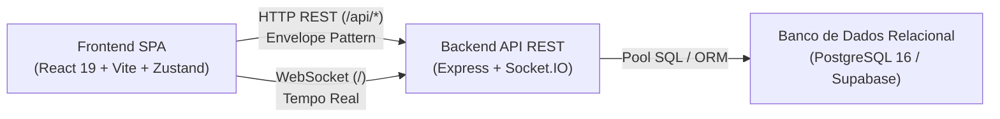

# Regras de Arquitetura e Organização Completa do Ecossistema

> **Documento de referência obrigatório para todos os integrantes da equipe e agentes de IA que contribuírem com este projeto.**  
> Toda nova funcionalidade, migração ou refatoração deve seguir rigorosamente as convenções, fluxos e camadas descritas aqui.

---

## 1. Visão Geral da Arquitetura

O projeto é organizado sob o modelo monorepo em três camadas auto-suficientes:

```text
Projeto/
├── Database/                 # Schema Mestre, Migrações DDL e Seeds de Carga
├── Backend/                  # API RESTful + Gateway WebSocket (Node.js + Express + TypeScript)
├── Frontend/                 # SPA Web (React 19 + Vite + Tailwind CSS v4 + Zustand)
├── docs/                     # Documentação técnica, especificações de contratos e Sprints
├── AGENTS.md                 # Diretrizes operacionais e Padrão de Engenharia de Cards
└── docker-compose.yml        # Orquestração do ambiente completo de desenvolvimento e produção
```



---

## 2. Banco de Dados (Database)

### 2.1 Estrutura de Diretórios
```text
Database/
├── database.sql              # Schema mestre consolidado (Single Source of Truth)
├── migrations/               # Migrações DDL sequenciais idempotentes (001_*.sql, 002_*.sql)
└── seeds/                    # Scripts DML de inserção de dados iniciais de teste
```

### 2.2 Regras de Schema e Normalização (3FN)
* **PKs e FKs sempre em UUID:** Utilizar `id UUID PRIMARY KEY DEFAULT gen_random_uuid()`. Proibido o uso de `SERIAL` ou inteiros autoincrementais para chaves públicas.
* **Timestamps padrão:** Todas as tabelas devem conter `created_at TIMESTAMPTZ DEFAULT TIMEZONE('utc', NOW()) NOT NULL` e `updated_at`.
* **Exclusão Lógica Obrigatória (Soft Delete):** Nenhuma tabela principal permite `hard delete` em produção; registros inativados recebem `status_ativo = false`.

---

## 3. Back-end (Backend)

### 3.1 Padrão Arquitetural: Clean MVC + Fat Service
O fluxo de execução das requisições segue uma via de mão única estrita:

$$\text{Request} \longrightarrow \text{Routes} \longrightarrow \text{Controller} \longrightarrow \text{Service} \longrightarrow \text{Model} \longrightarrow \text{Banco de Dados}$$

1. **Routes (`api/{feature}/routes/`):** Apenas mapeia o verbo HTTP e a URI para o método do Controller, aplicando middlewares de autenticação, rate-limit e validação de schema.
2. **Controller (`api/{feature}/controllers/`):** Responsável exclusivamente pelo protocolo HTTP: extrai parâmetros (`params`, `query`, `body`), valida a presença dos dados e repassa para o Service. Retorna a resposta HTTP formatada. **Nunca executa regras de negócio nem queries de banco.**
3. **Service (`api/{feature}/services/`):** O coração da aplicação (**Fat Service**). Contém 100% das regras de negócio, invariantes, cálculos, envio de eventos e orquestração de transações.
4. **Model (`api/{feature}/models/`):** Camada de dados responsável exclusivamente por executar queries no banco de dados e retornar entidades tipadas.

### 3.2 Envelope Pattern e Sanitização Estrita
Toda resposta de sucesso da API DEVE retornar o envelope padronizado:

```json
{
  "data": {
    "exemplo": {
      "id": "11111111-1111-4111-8111-111111111111",
      "nome": "Registro de Exemplo",
      "status_ativo": true
    },
    "meta": {
      "total": 1,
      "pagina": 1
    }
  },
  "message": "Operação realizada com sucesso."
}
```

É proibido retornar dados soltos na raiz de `data` ou vazar dados sensíveis (senhas, hashes).

---

## 4. Front-end (Frontend)

### 4.1 Arquitetura Orientada a Features (`src/features/`)
O código é organizado verticalmente por domínio de negócio:

```text
Frontend/src/features/exemplo/
├── pages/                    # Casca da tela, rotas e slots estruturais
├── components/               # Componentes atômicos e modulares com responsabilidade visual única
├── hooks/                    # Hooks customizados da feature
├── store/                    # Gerenciamento de estado global com Zustand
├── services/                 # Chamadas de API REST via HttpClient
├── types/                    # Interfaces e contratos tipados da feature
└── __test__/                 # Testes unitários e de integração no Vitest
```

### 4.2 Camada de Services e Chave de Mock
Toda requisição HTTP passa pelo `http` client (`src/core/api/http-client.ts`), utilizando `withFallback` ou `safeRequest`:
* Se `VITE_USE_MOCK_DATA=true`: consome dados locais mockados para desenvolvimento offline rápido.
* Se `VITE_USE_MOCK_DATA=false`: consome a API real do Backend e propaga erros adequadamente.

---

## 5. Como Adicionar uma Nova Funcionalidade (Passo a Passo)

1. **No Banco de Dados:**
   * Crie a migração sequencial `Database/migrations/NNN_nome_feature.sql`.
   * Atualize o schema consolidado em `Database/database.sql`.
2. **No Back-end:**
   * Crie o diretório `Backend/api/nome-feature/` com suas subpastas `controllers`, `services`, `models`, `routes`, `dtos`, `validators` e `test`.
   * Registre a rota no roteador mestre `Backend/api/index.ts`.
3. **No Front-end:**
   * Crie `Frontend/src/features/nome-feature/` com suas pastas `pages`, `components`, `store`, `services`, `types` e `__test__`.
   * Adicione a URL no dicionário central `Frontend/src/core/api/endpoints.ts`.
   * Registre a rota na aplicação em `Frontend/src/routes/index.tsx`.
